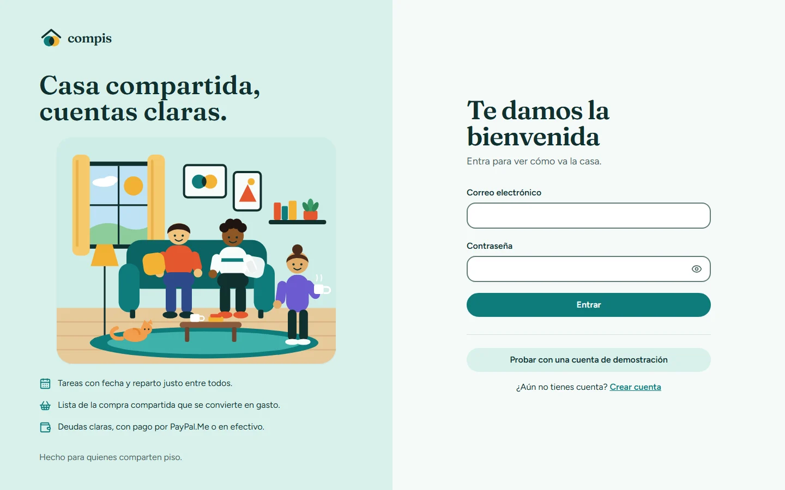
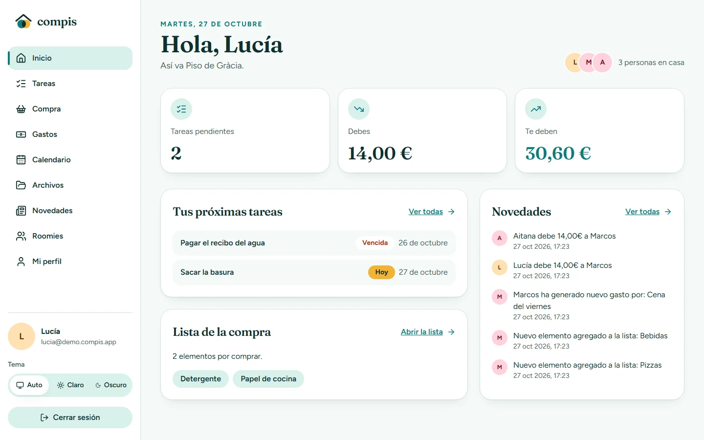
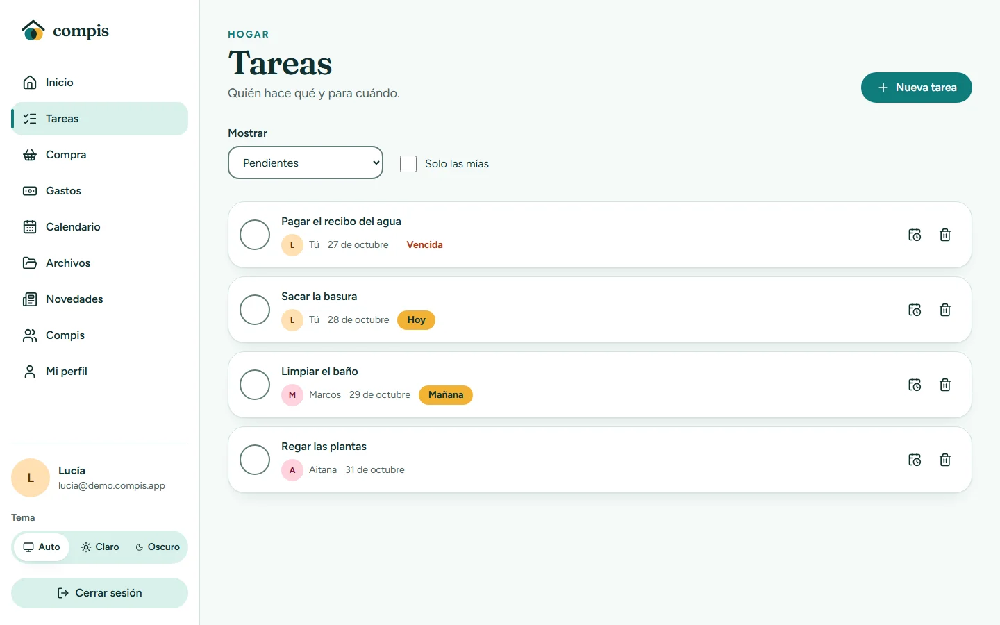
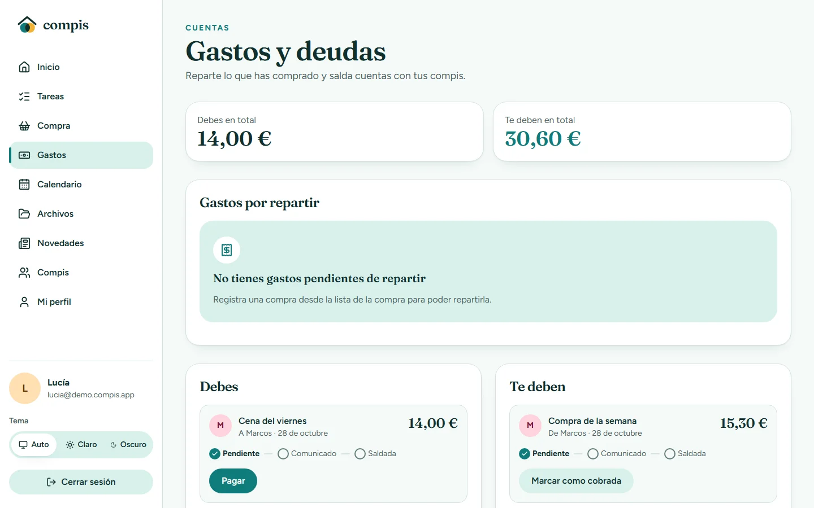
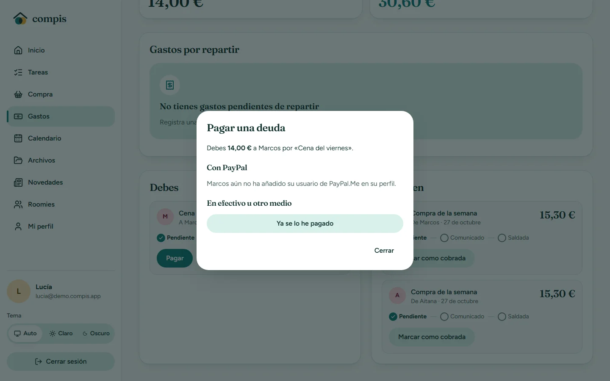
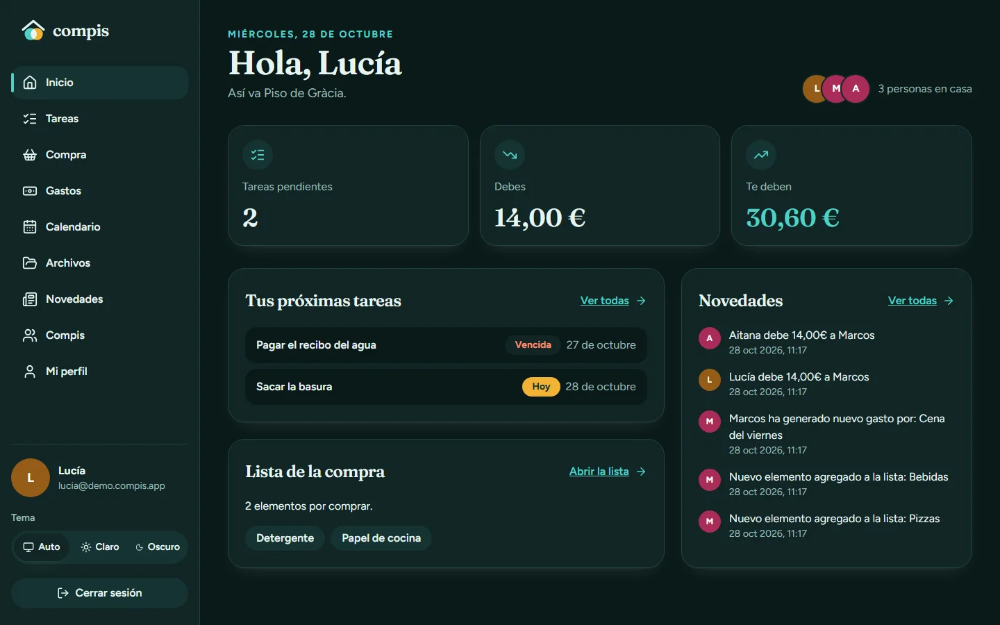
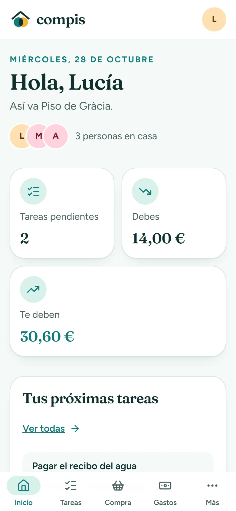
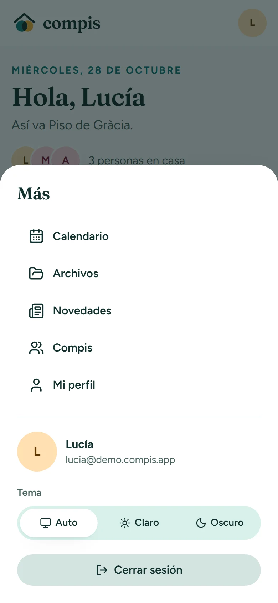
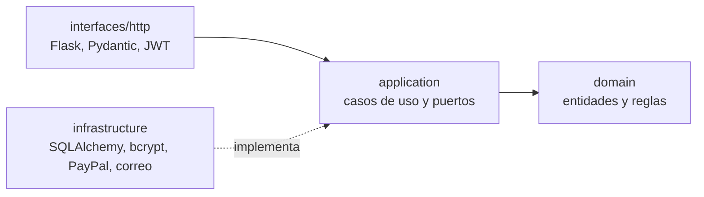

# Compis

**Casa compartida, cuentas claras.**

Compis es una aplicación web para gestionar la vida en un piso compartido: tareas, lista de la compra, gastos, deudas entre compañeros, calendario y archivos. Se puede instalar como app en el móvil y cumple las pautas de accesibilidad WCAG 2.2 de nivel AA.

[](https://github.com/srdgz/compis/actions/workflows/ci.yml)

**Demo:** [compis.vercel.app](https://compis.vercel.app). Pulsa «Probar con una cuenta de demostración» o entra con cualquiera de estas cuentas (la contraseña es la misma para las tres):

| Cuenta | Contraseña |
| --- | --- |
| `lucia@demo.compis.app` | `compis-demo-2026` |
| `marcos@demo.compis.app` | `compis-demo-2026` |
| `aitana@demo.compis.app` | `compis-demo-2026` |

Los datos de la demo se recrean cada semana.

## Capturas

| Acceso | Inicio |
| --- | --- |
|  |  |

| Tareas | Gastos y deudas |
| --- | --- |
|  |  |

| Pagar una deuda | Tema oscuro |
| --- | --- |
|  |  |

| Móvil: inicio | Móvil: menú |
| --- | --- |
|  |  |

## Funcionalidades

- **Vivienda y compis.** Quien crea la vivienda es su administrador y puede añadir o quitar compañeros por correo. Cada persona puede tener foto de perfil.
- **Tareas.** Se asignan a un compañero con fecha, se completan, se reprograman y se eliminan. Las vencidas y las de hoy se destacan.
- **Lista de la compra.** Lista compartida. Al marcar lo comprado se registra un gasto.
- **Gastos y deudas.** Un gasto se reparte a partes iguales entre quienes elijas, con una vista previa de lo que toca a cada uno. El céntimo sobrante lo asume quien pagó.
- **Pagos entre compañeros.** El deudor paga con PayPal.Me o en efectivo y avisa; el acreedor confirma o rechaza el pago. Más abajo se explica por qué.
- **Calendario y novedades.** Tareas y vencimientos por mes, y un registro de lo que va pasando en la casa.
- **Archivos.** Contratos, facturas y tickets, subidos a Cloudinary.
- **Resumen diario por correo** de la actividad de la vivienda.
- **Aplicación instalable (PWA)** con un shell que funciona sin conexión.
- **Tema automático, claro u oscuro** y diseño adaptado a cualquier pantalla.

## Tecnologías

| Capa | Tecnología |
| --- | --- |
| Frontend | React 18, TypeScript, Vite, React Router, TanStack Query, Zod, Tailwind CSS |
| Backend | Python 3.12, Flask 3, SQLAlchemy 2, Alembic, Pydantic, JWT |
| Base de datos | PostgreSQL (Neon) en producción, SQLite en local y en tests |
| Pruebas | pytest, Vitest, Testing Library, MSW, Playwright, axe-core |
| Calidad | ruff, mypy, ESLint, Prettier |
| CI/CD | GitHub Actions, Dependabot, Vercel |
| Servicios | PayPal Sandbox, Cloudinary, SMTP |

## Arquitectura

El backend sigue una arquitectura limpia: las capas internas no conocen a las externas. Un test automático comprueba que `domain` y `application` no importan Flask, SQLAlchemy ni las capas exteriores.



- **`domain`**: entidades, errores y reglas puras, como el reparto de importes en céntimos y las transiciones de estado de una deuda.
- **`application`**: servicios (casos de uso) que comprueban permisos y orquestan, y los puertos que describen lo que necesitan del exterior.
- **`infrastructure`**: modelos y repositorios SQLAlchemy, unidad de trabajo, hash de contraseñas, pasarela de PayPal y correo.
- **`interfaces`**: blueprints de Flask, validación de entrada, serializadores y comandos de consola.

El frontend se organiza por funcionalidad (`features/<área>`), cada una con su cliente de API, sus hooks de datos y sus páginas. Las respuestas del servidor se validan en tiempo de ejecución con Zod.

## Pagos entre compañeros

PayPal cobra siempre a una cuenta de comercio, así que no permite pagos directos entre particulares desde una aplicación sin que cada usuario pase por un proceso de alta de empresa. Por eso Compis separa dos cosas:

- **Pago real: PayPal.Me, efectivo y confirmación.** Cada persona guarda su usuario de [PayPal.Me](https://www.paypal.me). Al pagar, la aplicación abre `paypal.me/usuario/importeEUR` con la cantidad ya rellenada. Después el deudor avisa de que ha pagado y el acreedor lo confirma o lo rechaza. La deuda pasa por tres estados: pendiente, comunicada y saldada. Nadie puede saldar su propia deuda sin que el acreedor lo confirme.
- **Modo demostración: PayPal Sandbox.** Si el servidor tiene credenciales de Sandbox, el diálogo de pago muestra los botones de PayPal. El pedido se crea y se captura en el servidor, que solo salda la deuda si el estado, el importe, la moneda y la referencia coinciden. El código solo habla con el entorno de pruebas, y el dinero es ficticio.

## Accesibilidad y diseño responsive

- Se diseñó para WCAG 2.2 nivel AA: contraste de texto de al menos 4,5:1 y de controles de al menos 3:1 en los tres modos de color (un test lo verifica), foco visible, objetivos táctiles amplios, navegación completa por teclado, enlace para saltar al contenido, diálogos nativos con foco atrapado, anuncios de estado y errores asociados a su campo.
- axe-core revisa todas las páginas y diálogos en tests unitarios y, con comprobación real de contraste, en el navegador, en tema claro y oscuro.
- La interfaz se adapta a seis tamaños de pantalla, desde 320 px hasta Full HD y móvil en horizontal. Hay menú lateral en pantallas grandes y barra inferior con una hoja «Más» en las pequeñas. Las pruebas comprueban que ninguna página desborda horizontalmente.
- Las páginas de acceso siguen siempre el tema del navegador. El tema se elige desde el menú lateral.

Axe detecta solo una parte de los problemas posibles. Una revisión manual con lector de pantalla sigue siendo recomendable.

## Seguridad

- Todos los datos exigen sesión y pertenecer a la vivienda. Los permisos se comprueban en la capa de aplicación, no en el cliente.
- El token solo contiene el identificador de la persona; el rol y la vivienda se leen de la base de datos.
- Contraseñas con bcrypt, de al menos ocho caracteres, y límites en los enlaces de imágenes y archivos, que solo se aceptan si apuntan a tu cuenta de Cloudinary.
- Importes guardados en céntimos enteros.
- El resumen diario se dispara con un secreto que Vercel Cron envía como cabecera.

## Empezar en local

Necesitas Python 3.12 o superior y Node 22 o superior.

### Backend

```bash
python -m venv .venv
.venv/Scripts/activate        # en macOS y Linux: source .venv/bin/activate
pip install -r backend/requirements-dev.txt
cd backend
cp .env.example .env          # en PowerShell: Copy-Item .env.example .env
```

Edita `backend/.env` y pon una `JWT_SECRET_KEY` de al menos 32 caracteres. Puedes generarla con `python -c "import secrets; print(secrets.token_urlsafe(48))"`. Después:

```bash
flask --app compis.bootstrap:create_app db upgrade
flask --app compis.bootstrap:create_app seed-demo
flask --app compis.bootstrap:create_app run --port 5000
```

### Frontend

```bash
cd frontend
npm install
npm run dev
```

Abre [http://localhost:3000](http://localhost:3000). Vite redirige `/api` al backend en el puerto 5000.

### Variables de entorno

Todas son opcionales salvo `JWT_SECRET_KEY`.

| Variable | Dónde | Para qué |
| --- | --- | --- |
| `DATABASE_URL` | backend | Base de datos. Por defecto, SQLite local |
| `JWT_SECRET_KEY` | backend | Firma de sesiones (obligatoria) |
| `JWT_EXPIRES_HOURS` | backend | Duración de la sesión. Por defecto, 8 |
| `CORS_ORIGINS` | backend | Orígenes permitidos, separados por comas |
| `CRON_SECRET` | backend | Secreto del resumen diario por HTTP |
| `MAIL_SERVER`, `MAIL_PORT`, `MAIL_USERNAME`, `MAIL_PASSWORD`, `MAIL_USE_TLS`, `MAIL_USE_SSL`, `MAIL_SENDER` | backend | Envío del resumen diario |
| `PAYPAL_DEMO_CLIENT_ID`, `PAYPAL_DEMO_CLIENT_SECRET` | backend | Modo demostración con PayPal Sandbox |
| `CLOUDINARY_CLOUD_NAME` | backend | Restringe las imágenes y archivos a tu cuenta |
| `VITE_API_URL` | frontend | Prefijo de la API. Por defecto, `/api` |
| `VITE_CLOUDINARY_CLOUD_NAME`, `VITE_CLOUDINARY_UPLOAD_PRESET` | frontend | Subida de fotos y archivos |

Para el modo demostración crea una app en modo Sandbox en [developer.paypal.com](https://developer.paypal.com). Para la subida de archivos crea una cuenta en Cloudinary y un *upload preset* sin firma, preferiblemente limitado a imágenes y documentos.

Los archivos `.env` no se versionan. Nunca subas credenciales reales a los archivos `.env.example`.

### Comandos útiles

```bash
flask --app compis.bootstrap:create_app reset-demo    # recrea solo las cuentas de demostración
flask --app compis.bootstrap:create_app send-digest   # envía el resumen diario ahora
```

## Tests y calidad

```bash
cd backend
ruff check . && ruff format --check . && mypy compis && pytest --cov=compis
```

```bash
cd frontend
npm run lint && npm run typecheck && npx prettier --check . && npm test
npx playwright install chromium    # solo la primera vez
npm run e2e
```

- **Backend:** pruebas de dominio, de la API completa con permisos, de pagos con una pasarela simulada, de la capa de arquitectura y del punto de entrada de Vercel.
- **Frontend:** pruebas unitarias y de integración con Testing Library y MSW, contraste de la paleta, accesibilidad con axe y el service worker.
- **End-to-end:** Playwright arranca su propio backend y frontend con una base de datos temporal y recorre los flujos principales, la accesibilidad con contraste real y seis tamaños de pantalla.

Las capturas de este README se regeneran con `npm run screenshots`.

## CI/CD y despliegue

- **CI** (`.github/workflows/ci.yml`): en cada pull request y en `main` ejecuta el lint, los tipos, los tests y el build, y después los tests end-to-end.
- **Base de datos** (`.github/workflows/database.yml`): aplica las migraciones cuando cambian y recrea las cuentas de demostración cada semana. Necesita el secreto `DATABASE_URL` en el entorno `production`.
- **Dependabot** agrupa las actualizaciones semanales de Python, npm y las acciones de GitHub.
- **Vercel** sirve el frontend estático y el backend como función Python en el mismo dominio (`vercel.json` y `api/index.py`), con Postgres en Neon. Cada push a `main` se despliega automáticamente.

Para desplegar tu propia copia:

1. Importa el repositorio en Vercel con el preset **Other** y Node 22.
2. Conecta una base de datos Neon desde la pestaña Storage, que añade `DATABASE_URL`.
3. Añade `JWT_SECRET_KEY`, `CRON_SECRET`, `CLOUDINARY_CLOUD_NAME` y las variables `VITE_CLOUDINARY_*`. PayPal Sandbox y el correo son opcionales.
4. En GitHub crea el entorno `production` con el secreto `DATABASE_URL` y ejecuta el workflow **Database** marcando `reset_demo`.

## API

Todas las rutas cuelgan de `/api` y exigen sesión salvo las de acceso, `health`, `config` y `cron`.

| Área | Rutas |
| --- | --- |
| Acceso | `POST /signup`, `POST /login`, `POST /logout` |
| Compis | `GET /roomie/{id}`, `GET /roomie/home/{id}`, `PUT /roomie/{id}`, `PUT /roomie/delete/{id}` |
| Vivienda | `GET /home/{id}`, `POST /home`, `POST /home/{id}`, `DELETE /home/{id}/{roomie}`, `PUT /home/{id}` |
| Tareas | `GET /task/home/{id}`, `GET /task/roomie/{id}`, `POST /task`, `PUT /task/{id}`, `PUT /task/date/{id}`, `DELETE /task/{id}` |
| Compra | `GET /list/home/{id}`, `GET /item/list/{id}`, `POST /item`, `DELETE /item/{id}` |
| Gastos y deudas | `GET /expense/roomie/{id}`, `POST /expense`, `GET /debts/roomie/{id}`, `POST /debts`, `POST /debts/{id}/report`, `POST /debts/{id}/confirm`, `POST /debts/{id}/reject` |
| Pagos de demostración | `POST /payments/paypal/orders`, `POST /payments/paypal/capture` |
| Archivos | `GET /file/home/{id}`, `POST /file`, `DELETE /file/{id}` |
| Novedades y calendario | `GET /blog/home/{id}`, `GET /calendar/{id}` |
| Sistema | `GET /health`, `GET /config`, `GET /cron/digest` |

## Estructura del repositorio

```text
api/                   Punto de entrada de la función de Vercel
backend/
  compis/
    domain/            Entidades, errores y reglas
    application/       Casos de uso y puertos
    infrastructure/    Persistencia y adaptadores
    interfaces/        API HTTP y comandos de consola
  migrations/          Migraciones de Alembic
  tests/
frontend/
  src/
    app/               Rutas, estructura y navegación
    features/          Una carpeta por funcionalidad
    shared/            Cliente de API, componentes y utilidades
  e2e/                 Pruebas end-to-end con Playwright
  public/              Manifest, iconos y service worker
docs/screenshots/      Imágenes de este README
.github/               Workflows y Dependabot
```

## Licencia

Distribuido bajo la licencia MIT. Consulta el archivo [LICENSE](LICENSE).
