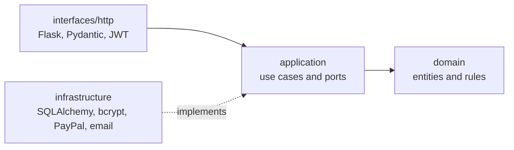

# Compis

**English** | [Español](README.es.md)

**Casa compartida, cuentas claras.** (Shared home, clear accounts.)

Compis is a web app for running a shared flat: tasks, a shopping list, expenses, debts between flatmates, a calendar and files. It can be installed as a phone app and follows the WCAG 2.2 level AA accessibility guidelines.

[](https://github.com/srdgz/compis/actions/workflows/ci.yml)

**Demo:** [compis.vercel.app](https://compis.vercel.app). Press "Probar con una cuenta de demostración" (try a demo account) or sign in with any of these accounts (the password is the same for all three):

| Account | Password |
| --- | --- |
| `lucia@demo.compis.app` | `compis-demo-2026` |
| `marcos@demo.compis.app` | `compis-demo-2026` |
| `aitana@demo.compis.app` | `compis-demo-2026` |

Demo data is recreated every week. The interface is currently in Spanish.

## Screenshots

| Sign in | Home |
| --- | --- |
|  |  |

| Tasks | Expenses and debts |
| --- | --- |
|  |  |

| Paying a debt | Dark theme |
| --- | --- |
|  |  |

| Mobile: home | Mobile: menu |
| --- | --- |
|  |  |

## Features

- **Home and flatmates.** Whoever creates the home becomes its administrator and can add or remove flatmates by email. Everyone can have a profile picture.
- **Tasks.** Assigned to a flatmate with a date, then completed, rescheduled or deleted. Overdue tasks and tasks due today stand out.
- **Shopping list.** A shared list. Marking items as bought records an expense.
- **Expenses and debts.** An expense is split equally among the people you choose, with a preview of each share. Whoever paid absorbs any leftover cent.
- **Payments between flatmates.** The debtor pays with PayPal.Me or in cash and reports it; the creditor confirms or rejects the payment. See below for why it works this way.
- **Calendar and activity.** Tasks and due dates by month, plus a log of what happens in the home.
- **Files.** Contracts, bills and receipts, uploaded to Cloudinary.
- **Daily email digest** of the home's activity.
- **Installable app (PWA)** with a shell that works offline.
- **Automatic, light or dark theme** and a layout that adapts to any screen.

## Tech stack

| Layer | Technology |
| --- | --- |
| Frontend | React 18, TypeScript, Vite, React Router, TanStack Query, Zod, Tailwind CSS |
| Backend | Python 3.12, Flask 3, SQLAlchemy 2, Alembic, Pydantic, JWT |
| Database | PostgreSQL (Neon) in production, SQLite locally and in tests |
| Testing | pytest, Vitest, Testing Library, MSW, Playwright, axe-core |
| Quality | ruff, mypy, ESLint, Prettier |
| CI/CD | GitHub Actions, Dependabot, Vercel |
| Services | PayPal Sandbox, Cloudinary, SMTP |

## Architecture

The backend follows a clean architecture: inner layers know nothing about outer ones. An automated test checks that `domain` and `application` never import Flask, SQLAlchemy or the outer layers.



- **`domain`**: entities, errors and pure rules, such as splitting amounts in cents and the debt state transitions.
- **`application`**: services (use cases) that check permissions and orchestrate, and the ports that describe what they need from the outside.
- **`infrastructure`**: SQLAlchemy models and repositories, unit of work, password hashing, the PayPal gateway and email.
- **`interfaces`**: Flask blueprints, input validation, serializers and console commands.

The frontend is organised by feature (`features/<area>`), each with its own API client, data hooks and pages. Server responses are validated at runtime with Zod.

## Payments between flatmates

PayPal always charges a merchant account, so it does not allow direct payments between individuals from an app unless every user goes through a business onboarding process. That is why Compis keeps two things apart:

- **Real payment: PayPal.Me, cash and confirmation.** Each person saves their [PayPal.Me](https://www.paypal.me) username. When paying, the app opens `paypal.me/username/amountEUR` with the amount already filled in. The debtor then reports the payment and the creditor confirms or rejects it. A debt goes through three states: pending, reported and settled. Nobody can settle their own debt without the creditor's confirmation.
- **Demo mode: PayPal Sandbox.** If the server has Sandbox credentials, the payment dialog shows the PayPal buttons. The order is created and captured on the server, which only settles the debt when status, amount, currency and reference all match. The code only talks to the test environment, and the money is fake.

## Accessibility and responsive design

- Designed for WCAG 2.2 level AA: text contrast of at least 4.5:1 and control contrast of at least 3:1 in all three colour modes (a test verifies it), visible focus, generous touch targets, full keyboard navigation, a skip link, native dialogs that trap focus, status announcements and errors tied to their fields.
- axe-core checks every page and dialog in unit tests and, with real contrast checks, in the browser, in the light and dark themes.
- The interface adapts to six screen sizes, from 320 px up to Full HD and phones in landscape. There is a sidebar on large screens and a bottom bar with a "More" sheet on small ones. The tests check that no page overflows horizontally.
- The sign-in pages always follow the browser theme. The theme is chosen from the sidebar.

Axe finds only part of the possible problems. A manual review with a screen reader is still recommended.

## Security

- All data requires a session and membership of the home. Permissions are checked in the application layer, not in the client.
- The token only holds the person's identifier; the role and home are read from the database.
- Passwords are hashed with bcrypt and must be at least eight characters. Image and file links are limited and only accepted if they point to your Cloudinary account.
- Amounts are stored as whole cents.
- The daily digest is triggered with a secret that Vercel Cron sends as a header.

## Getting started locally

You need Python 3.12 or later and Node 22 or later.

### Backend

```bash
python -m venv .venv
.venv/Scripts/activate        # on macOS and Linux: source .venv/bin/activate
pip install -r backend/requirements-dev.txt
cd backend
cp .env.example .env          # in PowerShell: Copy-Item .env.example .env
```

Edit `backend/.env` and set a `JWT_SECRET_KEY` of at least 32 characters. You can generate one with `python -c "import secrets; print(secrets.token_urlsafe(48))"`. Then:

```bash
flask --app compis.bootstrap:create_app db upgrade
flask --app compis.bootstrap:create_app seed-demo
flask --app compis.bootstrap:create_app run --port 5000
```

### Frontend

```bash
cd frontend
npm install
npm run dev
```

Open [http://localhost:3000](http://localhost:3000). Vite proxies `/api` to the backend on port 5000.

### Environment variables

All of them are optional except `JWT_SECRET_KEY`.

| Variable | Where | Purpose |
| --- | --- | --- |
| `DATABASE_URL` | backend | Database. Defaults to a local SQLite file |
| `JWT_SECRET_KEY` | backend | Session signing key (required) |
| `JWT_EXPIRES_HOURS` | backend | Session length. Defaults to 8 |
| `CORS_ORIGINS` | backend | Allowed origins, comma separated |
| `CRON_SECRET` | backend | Secret for the daily digest over HTTP |
| `MAIL_SERVER`, `MAIL_PORT`, `MAIL_USERNAME`, `MAIL_PASSWORD`, `MAIL_USE_TLS`, `MAIL_USE_SSL`, `MAIL_SENDER` | backend | Sending the daily digest |
| `PAYPAL_DEMO_CLIENT_ID`, `PAYPAL_DEMO_CLIENT_SECRET` | backend | Demo mode with PayPal Sandbox |
| `CLOUDINARY_CLOUD_NAME` | backend | Restricts images and files to your account |
| `VITE_API_URL` | frontend | API prefix. Defaults to `/api` |
| `VITE_CLOUDINARY_CLOUD_NAME`, `VITE_CLOUDINARY_UPLOAD_PRESET` | frontend | Uploading pictures and files |

For demo mode, create an app in Sandbox mode at [developer.paypal.com](https://developer.paypal.com). For file uploads, create a Cloudinary account and an unsigned *upload preset*, ideally limited to images and documents.

`.env` files are not versioned. Never commit real credentials to the `.env.example` files.

### Useful commands

```bash
flask --app compis.bootstrap:create_app reset-demo    # recreates only the demo accounts
flask --app compis.bootstrap:create_app send-digest   # sends the daily digest now
```

## Tests and quality

```bash
cd backend
ruff check . && ruff format --check . && mypy compis && pytest --cov=compis
```

```bash
cd frontend
npm run lint && npm run typecheck && npx prettier --check . && npm test
npx playwright install chromium    # first time only
npm run e2e
```

- **Backend:** domain tests, the full API with permissions, payments with a fake gateway, the architecture layers and the Vercel entry point.
- **Frontend:** unit and integration tests with Testing Library and MSW, palette contrast, accessibility with axe and the service worker.
- **End-to-end:** Playwright starts its own backend and frontend with a temporary database and walks through the main flows, accessibility with real contrast and six screen sizes.

The screenshots in this README are regenerated with `npm run screenshots`.

## CI/CD and deployment

- **CI** (`.github/workflows/ci.yml`): on every pull request and on `main` it runs linting, type checks, tests and the build, then the end-to-end tests.
- **Database** (`.github/workflows/database.yml`): applies migrations when they change and recreates the demo accounts every week. It needs the `DATABASE_URL` secret in the `production` environment.
- **Dependabot** groups the weekly updates for Python, npm and GitHub Actions.
- **Vercel** serves the static frontend and the backend as a Python function on the same domain (`vercel.json` and `api/index.py`), with Postgres on Neon. Every push to `main` is deployed automatically.

To deploy your own copy:

1. Import the repository into Vercel with the **Other** preset and Node 22.
2. Connect a Neon database from the Storage tab, which adds `DATABASE_URL`.
3. Add `JWT_SECRET_KEY`, `CRON_SECRET`, `CLOUDINARY_CLOUD_NAME` and the `VITE_CLOUDINARY_*` variables. PayPal Sandbox and email are optional.
4. In GitHub, create the `production` environment with the `DATABASE_URL` secret and run the **Database** workflow with `reset_demo` ticked.

## API

All routes live under `/api` and require a session except sign-in, `health`, `config` and `cron`.

| Area | Routes |
| --- | --- |
| Sign-in | `POST /signup`, `POST /login`, `POST /logout` |
| Flatmates | `GET /roomie/{id}`, `GET /roomie/home/{id}`, `PUT /roomie/{id}`, `PUT /roomie/delete/{id}` |
| Home | `GET /home/{id}`, `POST /home`, `POST /home/{id}`, `DELETE /home/{id}/{roomie}`, `PUT /home/{id}` |
| Tasks | `GET /task/home/{id}`, `GET /task/roomie/{id}`, `POST /task`, `PUT /task/{id}`, `PUT /task/date/{id}`, `DELETE /task/{id}` |
| Shopping | `GET /list/home/{id}`, `GET /item/list/{id}`, `POST /item`, `DELETE /item/{id}` |
| Expenses and debts | `GET /expense/roomie/{id}`, `POST /expense`, `GET /debts/roomie/{id}`, `POST /debts`, `POST /debts/{id}/report`, `POST /debts/{id}/confirm`, `POST /debts/{id}/reject` |
| Demo payments | `POST /payments/paypal/orders`, `POST /payments/paypal/capture` |
| Files | `GET /file/home/{id}`, `POST /file`, `DELETE /file/{id}` |
| Activity and calendar | `GET /blog/home/{id}`, `GET /calendar/{id}` |
| System | `GET /health`, `GET /config`, `GET /cron/digest` |

## Repository structure

```text
api/                   Entry point of the Vercel function
backend/
  compis/
    domain/            Entities, errors and rules
    application/       Use cases and ports
    infrastructure/    Persistence and adapters
    interfaces/        HTTP API and console commands
  migrations/          Alembic migrations
  tests/
frontend/
  src/
    app/               Routes, layout and navigation
    features/          One folder per feature
    shared/            API client, components and utilities
  e2e/                 End-to-end tests with Playwright
  public/              Manifest, icons and service worker
docs/screenshots/      Images used in this README
.github/               Workflows and Dependabot
```

## License

Released under the MIT licence. See the [LICENSE](LICENSE) file.
